# Aceptación visual del piloto A1, módulo 1

Revisión del reproductor real con el plan final, en navegador, a 1920 × 1080 y 390 × 844. Las capturas no son mockups. Se usó una ruta local temporal con los mismos `LessonHeader`, `GuidedLessonViewer` y renderers del estudiante; esa ruta se eliminó antes de publicar. La barra de revisión y el indicador de Next.js pertenecen al ensayo local.

## Comparación con referencias aprobadas

Cada pareja conserva entorno ilustrado completo, zona clara de lectura, título Georgia, texto navy, controles redondeados y navegación del reproductor aprobado. Las ilustraciones proceden del catálogo existente; el contenido y los escenarios son nuevos. Las referencias antiguas de consigna se interpretan con las correcciones posteriores del usuario: sin nivel prominente, menos texto, autocorrección al clic y un CTA principal.

| Familia | Referencia | Implementación real | Resultado |
|---|---|---|---|
| Modelo | 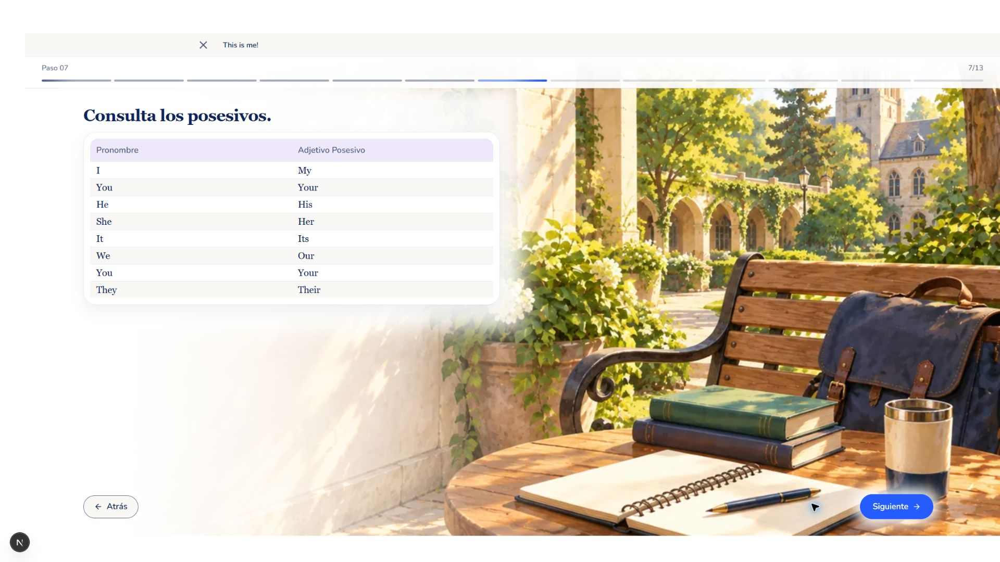 | 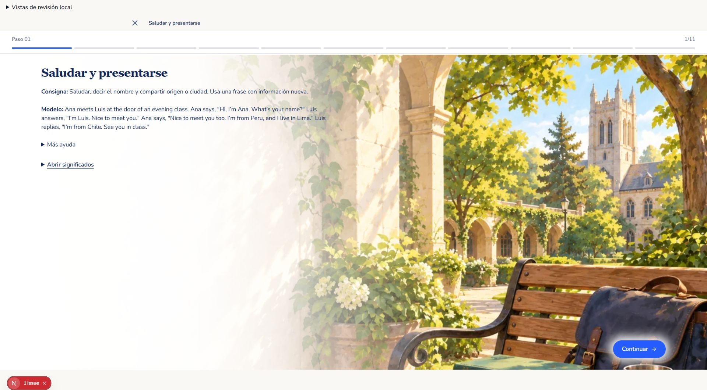 | Entorno reconocible, aproximadamente media pantalla con detalle; texto en zona clara; significados y ayuda desplegables. Pasa. |
| Escucha | 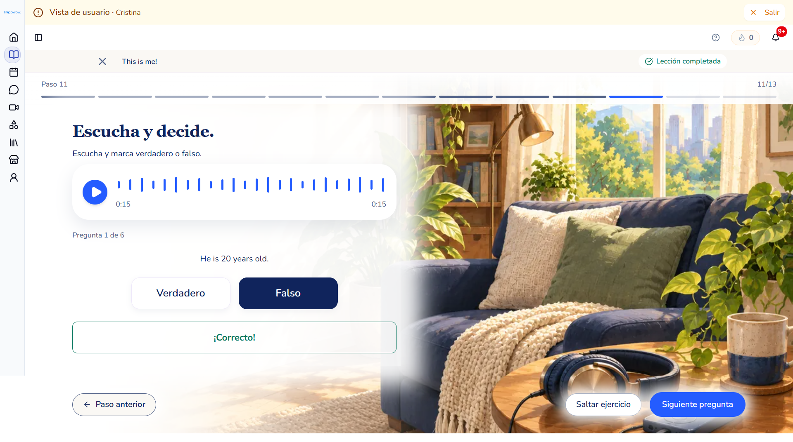 | 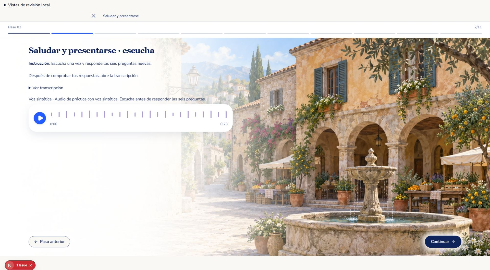 | Player blanco, botón circular, voz sintética visible, sin autoplay, transcripción separada. Pasa. |
| Selección correcta | 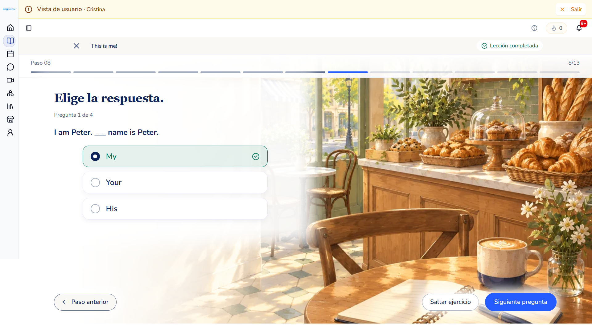 | 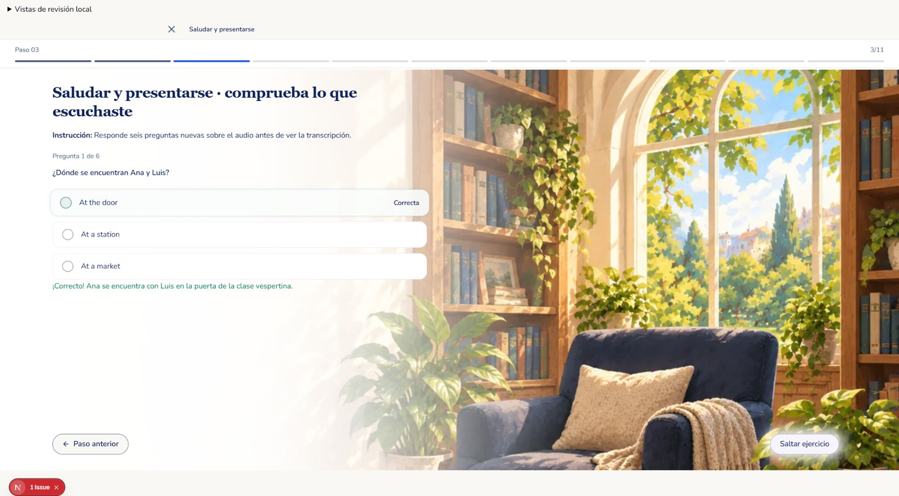 | Opciones verticales, comprobación al clic y feedback compacto. El avance automático se observó en la siguiente pregunta. Pasa. |
| Resultado incorrecto |  | 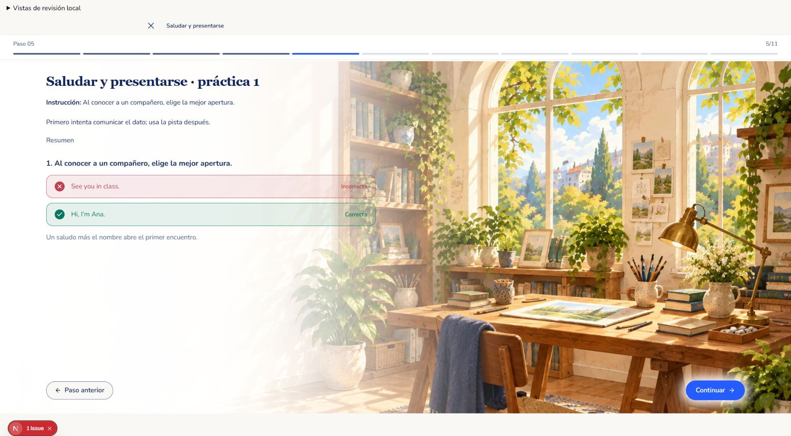 | Resultado incorrecto y respuesta correcta distinguibles por icono, texto y color; explicación breve; único Continuar. Pasa. |
| Hueco | 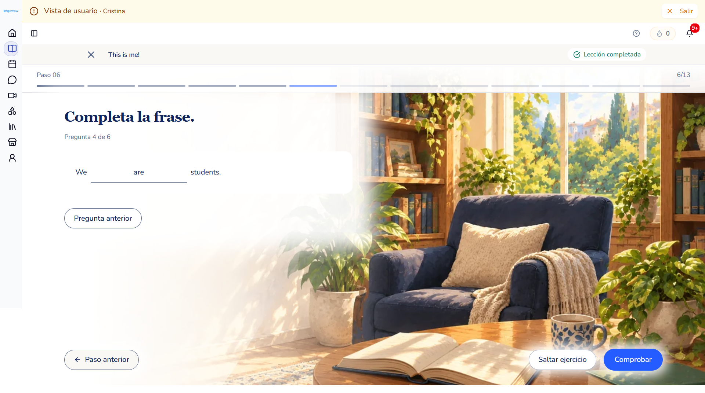 | 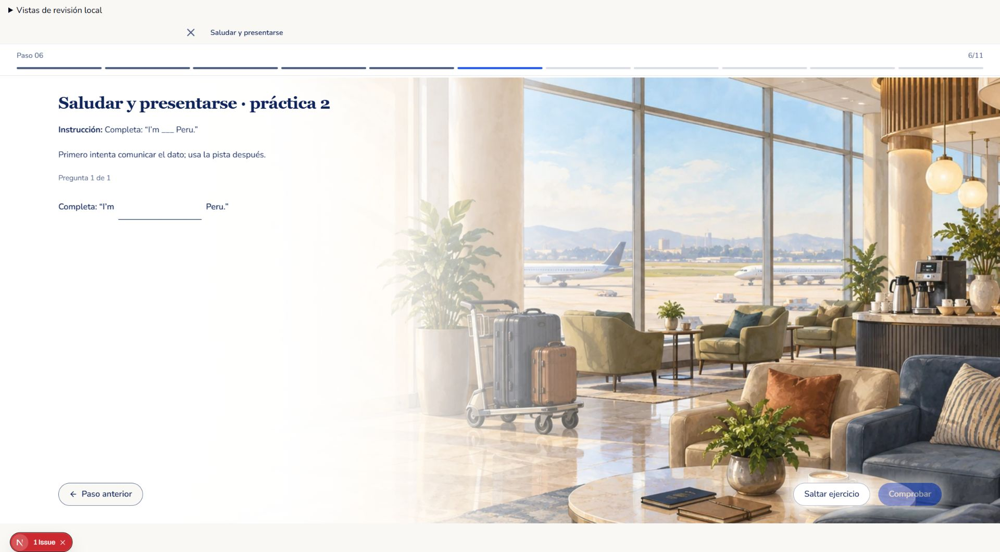 | Campo dentro de la oración. Se escribió `from`, se comprobó y se obtuvo resultado correcto. Pasa. |
| Oral | 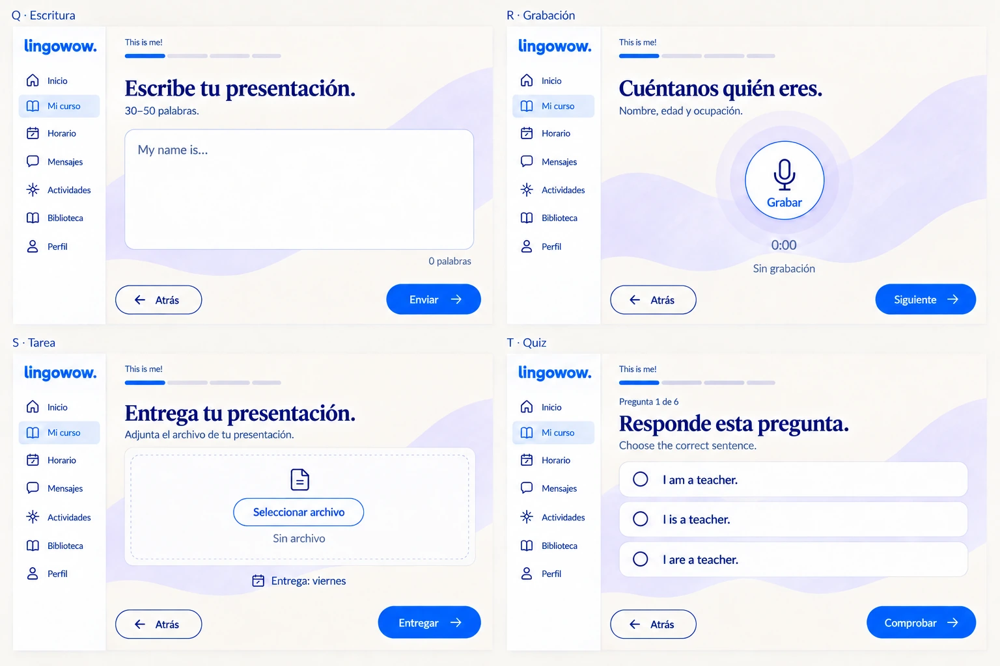 | 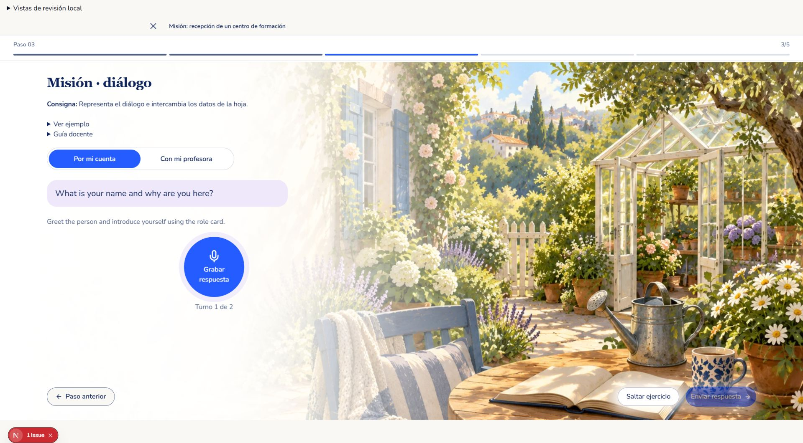 | Un selector, consigna breve, ejemplo y guía colapsados, micrófono 144 × 144 px con borde circular. Entorno completo según guía vigente. Pasa. |
| Acompañada |  | 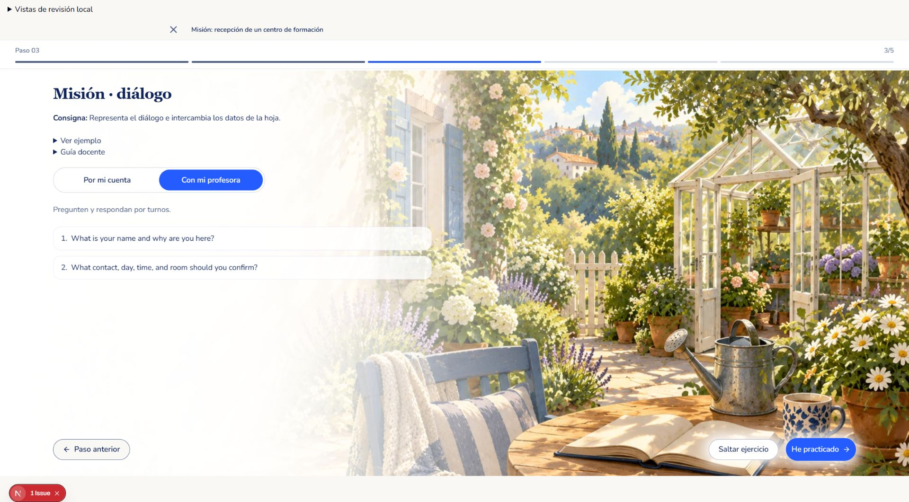 | Preguntas por turnos y CTA He practicado; no obliga a grabar. Pasa. |
| Escrita |  | 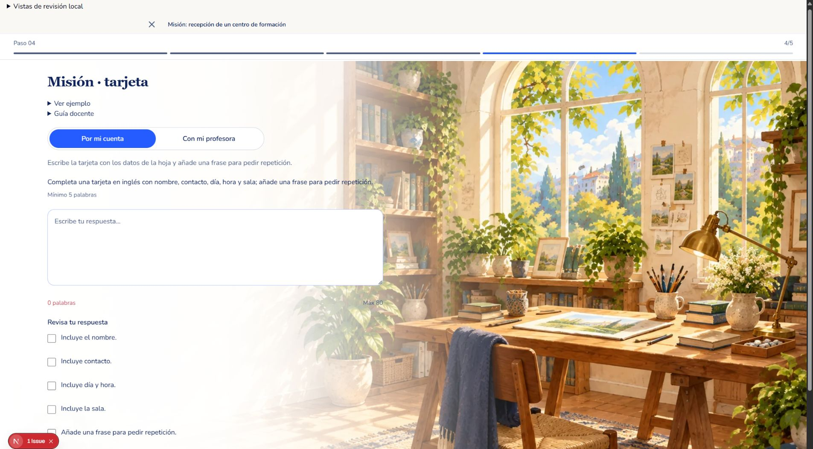 | Ejemplo desplegable, campo amplio, límites propios del piloto y criterios específicos de tarjeta. Pasa. |
| Misión |  | 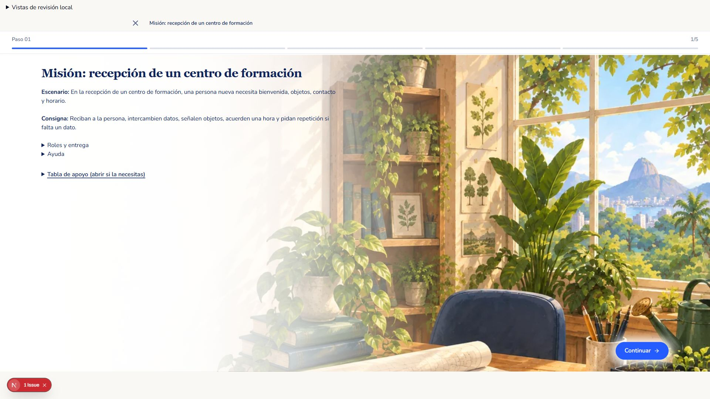 | Escenario y consigna visibles; roles, entrega y ayuda accesibles sin bloque técnico ni texto aglomerado. Pasa. |

## Móvil y cobertura

| Pantalla | Evidencia | Resultado |
|---|---|---|
| Escucha | [Captura](actual/u1-listening-mobile.jpg) | Player y transcripción legibles; entorno reconocible debajo del contenido. |
| Selección | [Captura](actual/u1-choice-mobile.jpg) | Opciones verticales, controles grandes, sin desbordamiento. |
| Hueco | [Captura](actual/u1-inline-mobile-top.jpg) | Campo dentro de la frase; no necesita otra línea de respuesta. |
| Oral | [Captura](actual/mission-recording-final-mobile.jpg) | Micrófono circular y entorno conservado. |
| Escrita | [Contenido](actual/mission-writing-mobile-top.jpg), [pie](actual/mission-writing-mobile-footer.jpg) | Área de escritura, criterios, ilustración y acciones accesibles mediante scroll. |

Se verificó ancho de documento menor o igual al viewport de 390 px. También se inspeccionaron los modelos de [U2](actual/u2-teaching-desktop.jpg), [U3](actual/u3-teaching-desktop.jpg), [U4](actual/u4-teaching-desktop.jpg) y [arranque](actual/starter-final-desktop.jpg), sin cambios posteriores en esas composiciones.

## Correcciones derivadas del ensayo real

- El audio de unidad estaba oculto bajo un desplegable: ahora el player siempre es visible y hay una sola transcripción.
- Las grabaciones tenían dos selectores: ahora hay uno.
- Una guía usaba Lima mientras la transferencia pedía Arequipa: se alinearon los datos activos.
- Ordenar usaba controles clásicos adicionales: en este piloto se reconstruye la frase con el renderer guiado, conservando tokens y respuesta.
- La misión mostraba notas internas de implementación: se retiraron del contenido del estudiante.
- La tarjeta escrita pedía grabar y utilizaba criterios del diálogo: se ajustó a su entrega real.

No hay desviaciones materiales pendientes en las familias inspeccionadas. Esta revisión verifica composición e interacción del renderer; no equivale a prueba humana de aprendizaje, calibración MCER ni revisión docente de pronunciación. La publicación y comprobación en DEV se registran por separado.
