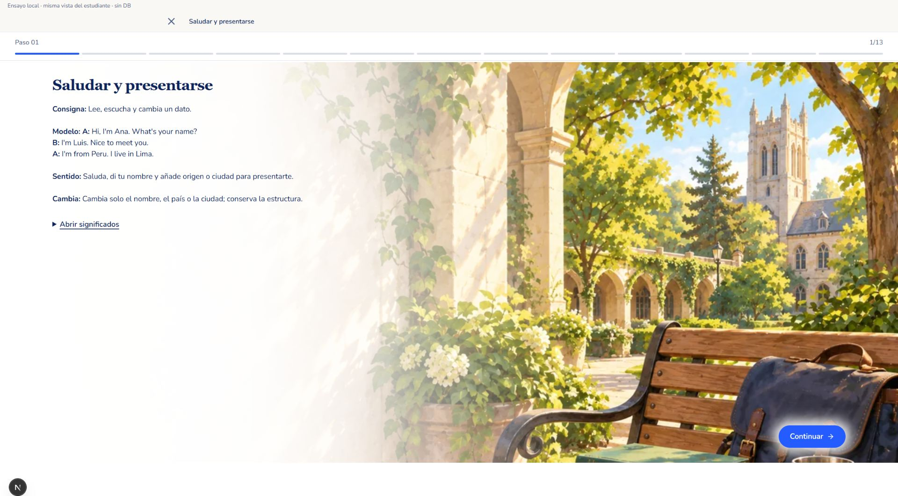
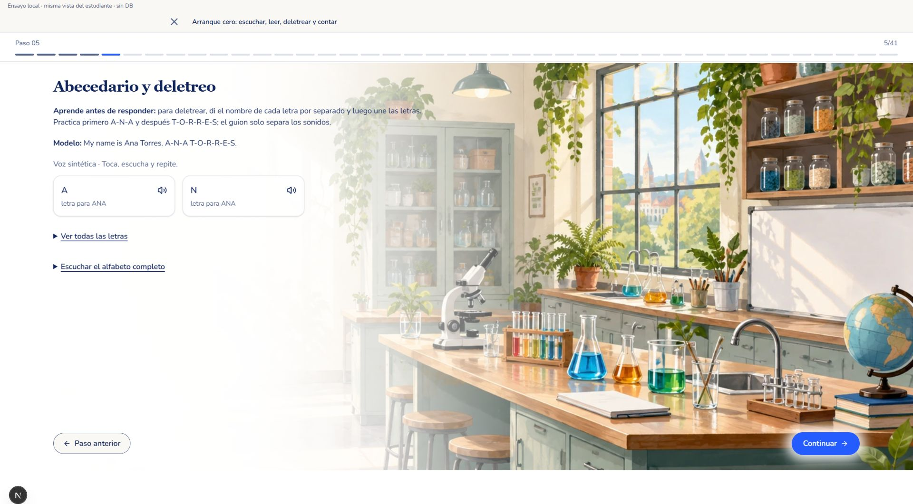
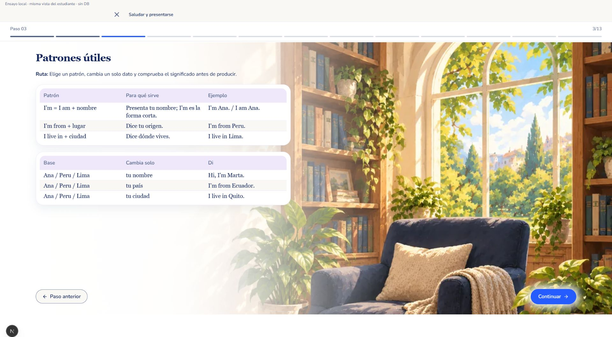
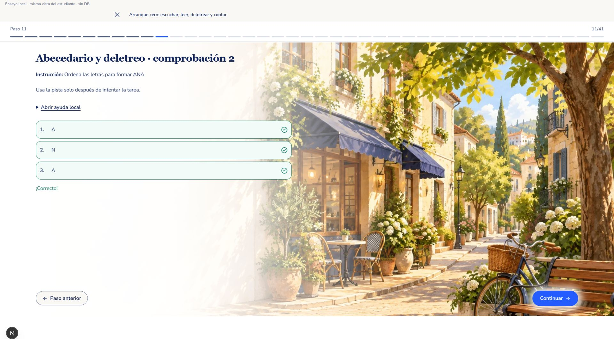
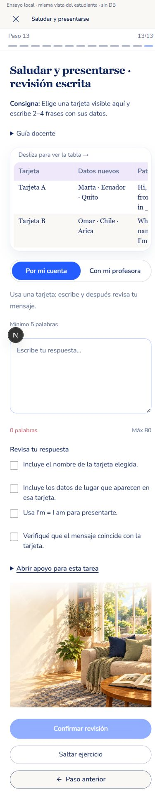
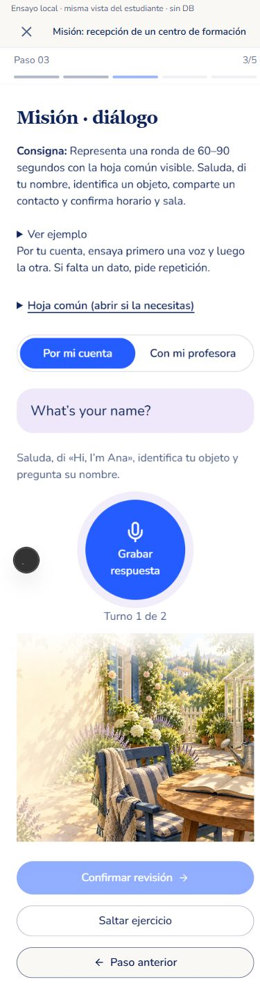
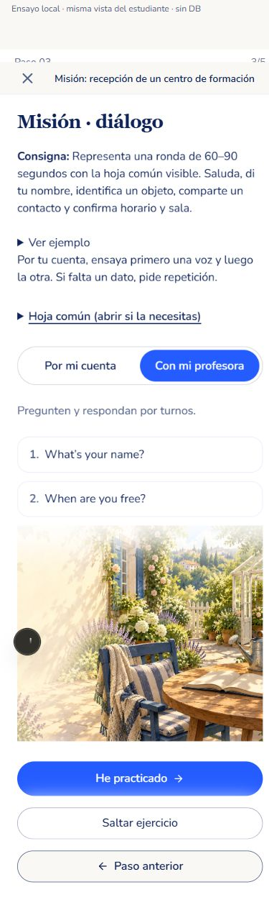
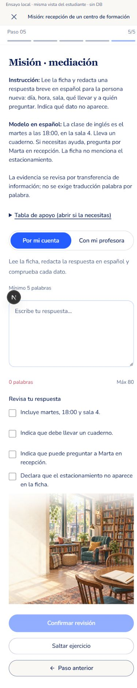

# Revisión docente del piloto A1

## Alcance y evidencia

Arranque, unidades 1–4 y misión: 98 escenas, 377 bloques. Se conservan los 237 IDs originales y los 11 archivos de audio anteriores; se añaden 62 clips sintéticos breves. Cada demanda dispone de explicación, modelo y apoyo previo. La guía docente complementa la enseñanza del estudiante.

Se capturó el renderer real en una ruta local temporal sin base de datos, usando LessonHeader y GuidedLessonViewer. La evidencia de escritorio tiene viewport real de 1920 × 1061; móvil, 390 px de ancho. La cabecera de ensayo y el indicador Next.js no forman parte del producto. Las capturas iniciales durante hidratación/transición se descartaron y reemplazaron tras montaje del reproductor, carga de imágenes y finalización de animaciones.

## Comparación con el diseño aprobado

Los entornos completos ilustrados de la guía vigente prevalecen sobre los primeros mockups de tarjetas. Se conservan ilustración amplia, zona clara para leer, título Georgia, navy, controles redondeados y navegación aprobada.

| Familia | Referencia aprobada | Implementación real | Resultado |
|---|---|---|---|
| Enseñanza |  |  | Entorno completo, modelo y propósito breves; significado opcional. Pasa. |
| Pronunciación |  |  | Botones de letra/frase, audio al clic, sin reproducción simultánea ni automática. Player original conservado como referencia opcional. Pasa. |
| Patrones |  |  | Estructuras con sentido y ejemplo antes de producir. Pasa. |
| Ordenación |  |  | Controles por fila, comprobación al completar y resultado integrado; una acción de continuación. La ordenación usa flechas propias de esta tarea. Pasa. |
| Producción escrita |  |  | Tarjeta con datos nuevos, una consigna visible, criterios específicos y entorno conservado. Pasa. |
| Conversación |  |  | Micrófono circular 144 × 144, selector único y revisión por turno; sin fingir calificación automática. Pasa. |
| Profesora |  |  | Preguntas y He practicado; no obliga a grabar. Pasa. |
| Mediación |  |  | Modelo en español, datos visibles mediante apoyo, criterios y pie accesibles. Pasa. |

## Cobertura

- [Arranque: 41/41 escenas](starter-visual.md).
- [Unidades: 52/52 escenas](units-visual.md).
- [Misión: 5/5 escenas](mission-visual.md).
- Evidencia individual de las 98 escenas en `actual/all-desktop/`.
- Móvil: letras, patrones, transferencia escrita, diálogo autónomo, profesora, tarjeta y mediación; contenido y controles accesibles mediante scroll. Ancho del documento = viewport (390 px).
- [Pie de mediación](actual/mission-mediation-mobile-footer.jpg). Tarjeta y mediación de escritorio también tienen capturas completas actualizadas.

No quedan desviaciones materiales en las familias inspeccionadas. No se verificó cada una de las 98 escenas en móvil ni una sesión autenticada de Joel: el usuario aplazó esa prueba. Esta aceptación acredita composición y comportamiento del renderer, no eficacia de aprendizaje ni revisión humana de pronunciación. Código desplegado y actualización transaccional de DEV se verifican por separado.

## Verificación técnica

179 archivos / 1286 pruebas JavaScript; lint y TypeScript verdes. 65 pruebas Python (incluidas las fuentes privadas del compilador); los tres checks de fuentes privadas se omiten únicamente en CI cuando esas fuentes no están disponibles. Simulación DEV: 237 IDs conservados, 377 registros y huellas del historial intactas.
